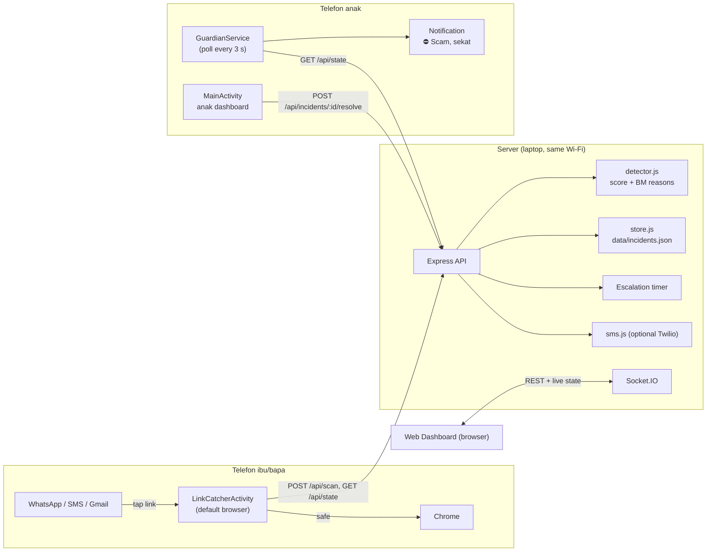
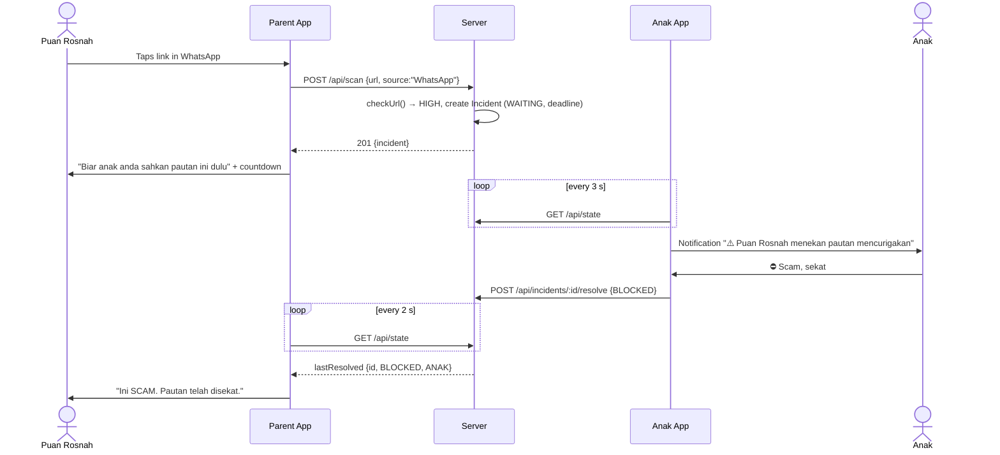
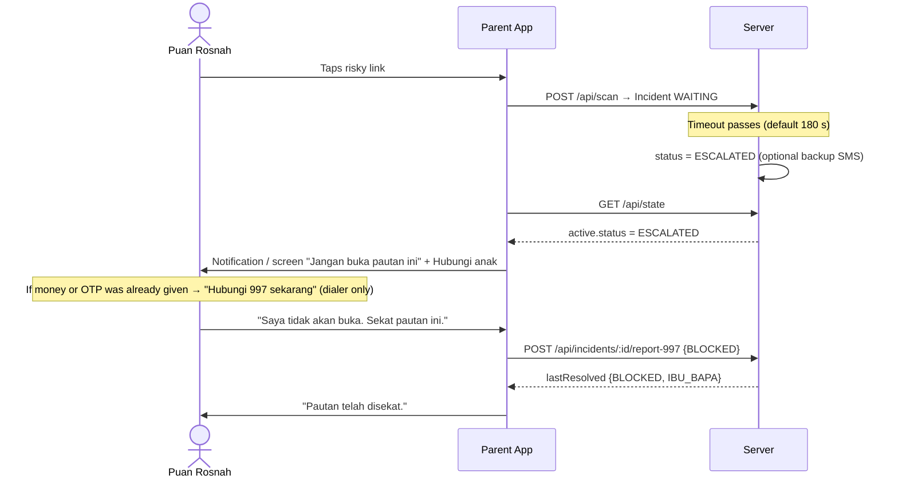
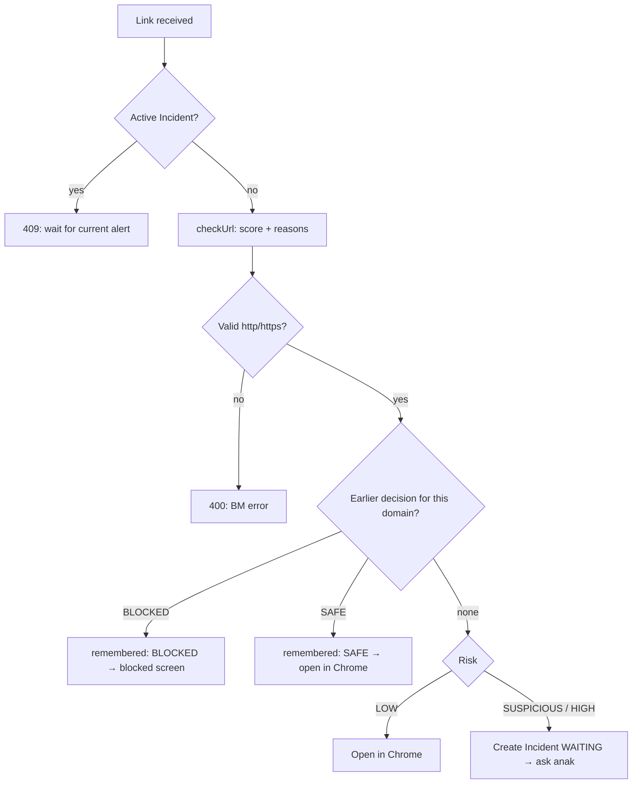
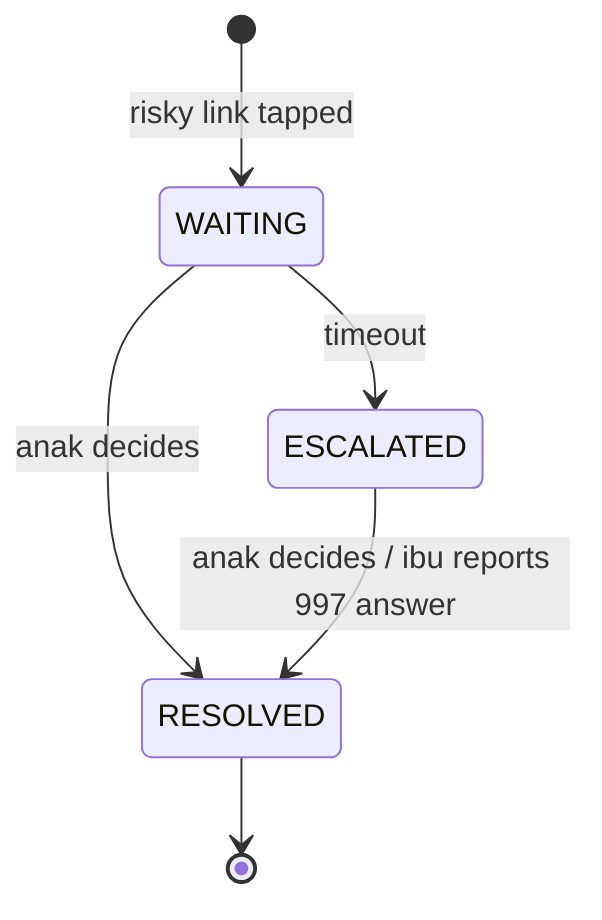

# Design Document

## Overview

Family Guard has three parts. All of them share one small server.

| Part | Who uses it | Technology |
|---|---|---|
| **Server** | Both phones | Node.js 20+, Express, Socket.IO, JSON file storage |
| **Android app** (one app, two modes) | Ibu/bapa phone and anak phone | Kotlin, Android SDK only (minSdk 26, targetSdk 35), no third-party libraries |
| **Web Dashboard** | Anak (optional), presenters | Plain HTML/CSS/JavaScript served by the Server |

### Key design decisions

| Decision | Why |
|---|---|
| The Parent App becomes the **default browser** | This is the only supported Android way to see a link tap from WhatsApp *before* the website loads. It needs no accessibility hacks or notification reading, so the phone still "feels normal" (Requirement 1). |
| Safe links are **handed to Chrome** | Puan Rosnah keeps the browser she knows. Family Guard never renders websites itself (Requirement 1.5). |
| Anak's phone **polls every 3 s** instead of using Firebase | This needs no cloud account or setup and works on the same Wi-Fi for the demo (Requirement 5.1). |
| **Server-side timer** | Escalation still happens if both phones are offline or the server restarts (Requirements 6.1 and 10.2). |
| **Remember decisions per domain** | Real WhatsApp messages cannot be deleted by another app, so a blocked site must stay blocked instead (Requirement 7). |
| **Heuristic rules**, not AI or a threat feed | They are transparent and explainable in BM, work offline, and are easy to test (Requirement 2). |
| **"Jangan buka" is the default** when offline | This makes the app fail safe for a trusting user (Requirement 10.1). |

## Architecture

## Main flows

### Scenario 1: Anak answers

### Scenario 2: No answer → 997

Only anak can allow a risky link. The server rejects `SAFE` from ibu/bapa with 403, so a trusting parent cannot unlock a link alone.

### Parent notifications (`ParentWatchService`)

When a risky link starts waiting, the Parent App also starts a small foreground service. If ibu/bapa leaves the waiting screen ("Kembali ke telefon"), the service keeps checking every 3 s. It posts a notification when anak decides (tapping "safe" opens the link in Chrome) or when the alert escalates. If the waiting screen is visible, the service does not notify, to avoid duplicates. It stops once the link is settled, or after 2 hours.

### Decision logic in `POST /api/scan`

## Components and interfaces

### Server (`server/`)

| File | Responsibility |
|---|---|
| `index.js` | HTTP API, sessions and roles, the escalation timer, Socket.IO live state, security headers |
| `detector.js` | `checkUrl(url, {simulate})` → `{risk, score, reasons[], domain, displayUrl, simulated}` |
| `store.js` | `IncidentStore`: incident history (latest 150), `active`, `rememberedDecision(domain)`, `deletedMessageIds()`, `resetDemo()`. Writes are atomic (temp file, then rename). |
| `sms.js` | Optional Twilio SMS to family numbers. Rejects short codes such as 997. |

**API**

| Method & path | Role | Purpose |
|---|---|---|
| `POST /api/auth` `{role, pin}` | any | Sign in and get a bearer token (valid 12 h) |
| `GET /api/state` | any | Active incident, last decision, names, timeout and stats. Anak also gets history. |
| `POST /api/scan` `{url, source?, messageId?, simulate?}` | ibu/bapa | Check a link. Returns `triggered`, `remembered` and `incident`. |
| `POST /api/incidents/:id/resolve` `{decision}` | anak | SAFE or BLOCKED |
| `POST /api/incidents/:id/report-997` `{decision: "BLOCKED"}` | ibu/bapa | Parent blocks the link after escalation. `SAFE` returns 403. |
| `POST /api/incidents/:id/escalate` | anak | Escalate manually |
| `POST /api/demo/reset` | any | Restore demo messages and forget remembered decisions |
| `GET /api/health` | none | Health check |

### Android app (`android/app/src/main/java/com/familyguard/app/`)

| Class | Responsibility |
|---|---|
| `LinkCatcherActivity` | Registered for `VIEW` + `BROWSABLE` on `http`/`https`. Shows the checking, waiting, escalated, safe, blocked, offline and busy screens. Polls the state every 2 s. |
| `MainActivity` | Setup (server address, role, PIN). Ibu/bapa home (protection status, test links). Anak dashboard (reasons, decision buttons). |
| `ParentWatchService` | Foreground service in ibu/bapa mode. Watches one waiting link after the parent leaves the screen, and notifies them of the decision or escalation. |
| `GuardianService` | Foreground service (`dataSync`) in anak mode. Polls every 3 s and posts one alert per new incident or status. |
| `Notifs` | Notification channels, the monitoring notification, and the alert with the "⛔ Scam, sekat" action |
| `DecisionReceiver` | Handles the notification action and calls `/resolve` |
| `Browsers` | Finds the real browser (Chrome first) and checks whether Family Guard holds the browser role |
| `Api`, `Prefs`, `Bg`, `Ui` | HTTP client with automatic re-login, saved settings, background tasks, and senior-friendly view builder |

### Web Dashboard (`public/`)

`app.js` renders both views. The **ibu/bapa** view is a WhatsApp-style demo phone with 4 sample chats. The **anak** view has the alert, reasons, decision buttons and history.

## Data model

**Incident** (stored in `data/incidents.json`)

| Field | Example | Notes |
|---|---|---|
| `id` | UUID | |
| `risk`, `score` | `HIGH`, `78` | |
| `domain`, `displayUrl` | `maybank-secure-verification.example`, `https://…/verify` | Query string and fragment removed |
| `reasons[]` | BM sentences | Shown to anak |
| `source` | `WhatsApp` | Plain text, max 60 characters |
| `messageId` | `bank-1` | Web demo only. Validated against `^[a-z0-9-]{1,40}$`. |
| `status` | `WAITING` → `ESCALATED` → `RESOLVED` | Only one WAITING/ESCALATED incident at a time |
| `decision`, `decidedBy` | `BLOCKED`, `ANAK` or `IBU_BAPA` | `IBU_BAPA` can only be BLOCKED. Older records may show `NSRC_997`. |
| `tips[]` | `"Ini bukan laman rasmi Maybank."` | Up to 2 plain reasons for ibu/bapa |
| `createdAt`, `expiresAt`, `escalatedAt`, `resolvedAt` | ISO time | |
| `simulated` | `false` | Demo mode |

**Incident state machine**

## Error handling

| Situation | Behaviour |
|---|---|
| Server unreachable | Parent App shows the offline screen with "Jangan buka" first (Requirement 10.1) |
| Session expired or server restarted | Apps sign in again with the saved PIN, and the timer is restored from disk |
| Second risky link while waiting | 409. The same domain resumes waiting; a different one shows "Satu pautan sedang disemak" |
| Invalid link or scheme | 400 with a BM message |
| No real browser installed | Toast: "Tiada pelayar lain dijumpai. Sila pasang Chrome." |
| Opening a link while in the background | Postponed until the parent returns, because Android blocks starting activities from the background |
| Notifications not allowed (anak) | Dashboard shows "Notifikasi dimatikan" with an allow button |

## Security considerations

- PINs are checked with `crypto.timingSafeEqual`. Failed attempts are rate-limited, and sessions expire after 12 h.
- Permissions are checked by role on every endpoint.
- The server binds to `127.0.0.1` by default. LAN access must be enabled explicitly.
- CSP, anti-framing, nosniff and no-referrer headers are sent. `X-Powered-By` is disabled.
- **Demo-only shortcuts** (the production version must remove these):
  - plain HTTP (cleartext allowed in the Android network config)
  - the PIN saved in app-private storage for automatic re-login
  - shared role PINs instead of individual accounts

## Testing strategy

| Level | What | How |
|---|---|---|
| Unit | Detector scoring and reasons, SMS safety | `node --test` (`tests/detector.test.js`, `tests/sms.test.js`) |
| API workflow | Auth, roles, scan → resolve, 409 on overlap, remembered decisions, restart restores the timer, timeout escalation | `tests/workflow.test.js` (isolated temporary server) |
| Android build | Compiles, lint has no errors | `gradle assembleDebug lintDebug` |
| Manual end-to-end | Scenarios 1 and 2 on an emulator or phone, plus the web dashboard | `docs/PANDUAN_ANDROID.md` demo script |
| **User testing (brief requirement)** | At least 3 people outside the team, ideally aged 55 or over | See tasks.md, task 9 |
